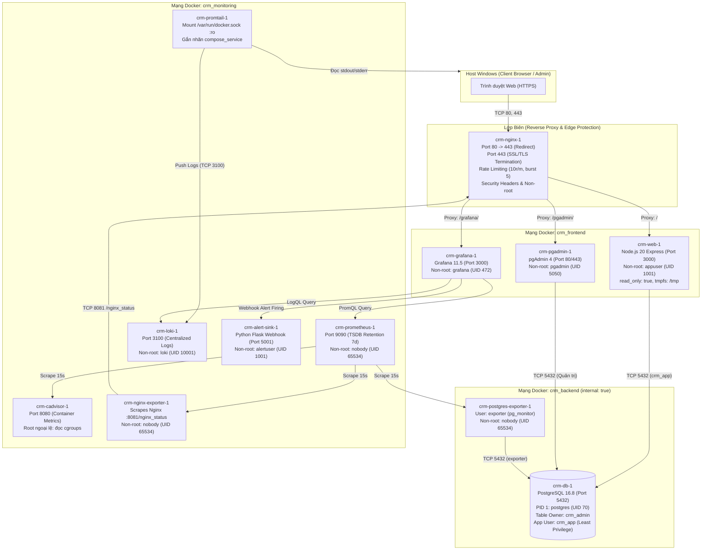

# Hệ thống CRM Chăm sóc Khách hàng (Customer Relationship Management) - Phiên Bản Tăng Cường Bảo Mật & Giám Sát Tập Trung

> **Môn học:** Triển khai và Quản trị Hệ thống Phần mềm  
> **Sinh viên thực hiện:** Dương Tiến Dũng  
> **Mã số sinh viên (MSSV):** DTC245180183  
> **Lớp:** KTPM K23B  
> **Email:** DTC245180183@ictu.edu.vn  
> **Repository GitHub:** `DTC245180183-crm-devops`

---

## 1. Giới thiệu Đề tài
Hệ thống **CRM Chăm sóc Khách hàng** cung cấp giải pháp chuyển đổi số toàn diện cho doanh nghiệp trong việc quản lý quan hệ khách hàng, tối ưu hóa quy trình bán hàng và chăm sóc sau bán hàng:
- **Hồ sơ khách hàng & Phân khúc**: Phân loại theo phân khúc (`new`, `regular`, `vip`, `inactive`) và nguồn tiếp cận (`website`, `referral`, `facebook`, `event`, `cold_call`, `other`).
- **Lịch sử tương tác (Timeline)**: Ghi nhận đa kênh các cuộc gọi, email, cuộc họp, ghi chú nội bộ và tin nhắn trao đổi.
- **Cơ hội bán hàng (Sales Pipeline Kanban)**: Quản lý các giai đoạn bán hàng theo chu trình chặt chẽ: `Mới tạo` $\rightarrow$ `Đã liên hệ` $\rightarrow$ `Đủ điều kiện` $\rightarrow$ `Gửi đề xuất` $\rightarrow$ `Thành công (Won)` / `Thất bại (Lost)`.
- **Phiếu hỗ trợ & khiếu nại (Support Tickets) có SLA**: Cam kết thời gian xử lý theo mức độ ưu tiên: Khẩn cấp (4 giờ), Cao (8 giờ), Trung bình (24 giờ), Thấp (72 giờ). Tự động cảnh báo nhãn "Quá hạn SLA". Hỗ trợ trao đổi bình luận và đính kèm tệp tài liệu an toàn (PNG, JPG, WEBP, PDF tối đa 2MB, xác thực magic bytes).
- **Lịch nhắc việc (Tasks)**: Quản lý công việc cá nhân, lọc việc hôm nay và việc quá hạn, phân công công việc từ cấp quản lý.
- **Dashboard KPI**: Báo cáo tổng quan dành cho Quản lý (doanh thu chốt, tỷ lệ thắng deal, ticket quá hạn SLA, thời gian xử lý trung bình) và dashboard cá nhân cho nhân viên.

### Phân quyền người dùng theo vai trò (RBAC)
- **`sales` (Kinh doanh)**: Xem khách hàng; tạo/sửa thông tin khách hàng; ghi nhận tương tác; quản lý pipeline cơ hội; tạo ticket; quản lý nhắc việc cá nhân.
- **`support` (Chăm sóc khách hàng)**: Xem khách hàng (chỉ đọc hồ sơ); ghi nhận tương tác; tiếp nhận và đổi trạng thái ticket theo quy trình; đính kèm tệp; xem cơ hội; quản lý nhắc việc cá nhân.
- **`manager` (Quản lý)**: Toàn quyền quản trị; lưu trữ/khôi phục khách hàng; phân công ticket và nhắc việc; quản trị tài khoản nhân sự (tạo, sửa, khóa/mở khóa tài khoản – có cơ chế chống tự khóa chính mình); xem toàn bộ dashboard KPI; xuất dữ liệu khách hàng ra CSV có cơ chế chống CSV Injection.

---

## 2. Sơ Đồ Kiến Trúc Hệ Thống (12 Containers & 3 Networks)



---

## 3. Danh Mục 12 Dịch Vụ Container (Fixed Tags)

| STT | Tên Container | Image & Tag Cố Định | User / Quyền Hạn | Mạng Docker | Mục Đích & Quyền Hạn |
| :--- | :--- | :--- | :--- | :--- | :--- |
| 1 | `crm-nginx-1` | `nginxinc/nginx-unprivileged:1.27.4-alpine` | `101:101` (nginx) | `frontend`, `monitoring` | Reverse Proxy, SSL, Rate limit, Security Headers |
| 2 | `crm-web-1` | `crm-web` (build từ `node:20.18.3-alpine`) | `1001:1001` (appuser) | `frontend`, `backend` | Ứng dụng CRM chính, `read_only: true`, `tmpfs: /tmp` |
| 3 | `crm-db-1` | `postgres:16.8-alpine` | PID 1: `70:70` (postgres) | `backend` (*internal*) | CSDL PostgreSQL, hoàn toàn cách ly bên ngoài |
| 4 | `crm-pgadmin-1` | `dpage/pgadmin4:9.1` | `5050:5050` (pgadmin) | `frontend`, `backend` | Quản trị CSDL qua web UI |
| 5 | `crm-prometheus-1`| `prom/prometheus:v3.2.1` | `65534:65534` (nobody) | `monitoring` | Lưu trữ metrics TSDB 7 ngày, `read_only: true` |
| 6 | `crm-grafana-1` | `grafana/grafana:11.5.2` | `472:472` (grafana) | `frontend`, `monitoring` | Trực quan hóa metrics & log, cảnh báo tự động |
| 7 | `crm-cadvisor-1` | `gcr.io/cadvisor/cadvisor:v0.49.2` | `0:0` (Root - Ngoại lệ) | `monitoring` | Giám sát CPU/RAM container; `read_only: true` |
| 8 | `crm-nginx-exporter-1` | `nginx/nginx-prometheus-exporter:1.4.1` | `65534:65534` (nobody) | `monitoring` | Thu thập metrics Nginx stub_status; `read_only: true` |
| 9 | `crm-postgres-exporter-1` | `prometheuscommunity/postgres-exporter:v0.16.0` | `65534:65534` (nobody) | `backend`, `monitoring` | Thu thập metrics hiệu năng PostgreSQL |
| 10 | `crm-loki-1` | `grafana/loki:3.4.2` | `10001:10001` (loki) | `monitoring` | Lưu trữ & đánh chỉ mục log tập trung |
| 11 | `crm-promtail-1` | `grafana/promtail:3.4.2` | `0:0` (Root - Ngoại lệ) | `monitoring` | Thu thập log container từ Docker daemon |
| 12 | `crm-alert-sink-1`| `crm-alert-sink` (build từ `python:3.11.11-alpine`) | `1001:1001` (alertuser)| `monitoring` | Nhận Webhook cảnh báo từ Grafana Alertmanager |

---

## 4. Bảng Địa Chỉ Truy Cập & Tài Khoản Mẫu

> **Lưu ý an toàn:** Mọi mật khẩu thực tế được bảo mật tuyệt đối trong tệp `.env` (quyền `chmod 600`), không hardcode trong mã nguồn. Dưới đây là danh sách tài khoản mẫu sau khi khởi tạo từ `.env.example`:

| Dịch vụ / Ứng dụng | Địa chỉ truy cập qua Nginx | Tài khoản mẫu | Mật khẩu | Vai trò & Chức năng |
|---|---|---|---|---|
| **Ứng dụng Web CRM** | `https://localhost/` | `admin` | *Xem `SEED_MANAGER_PASSWORD` trong `.env`* | Quản lý toàn quyền (Manager) |
| **Ứng dụng Web CRM** | `https://localhost/` | `sales01` | *Xem `SEED_SALES_PASSWORD` trong `.env`* | Nhân viên kinh doanh (Sales) |
| **Ứng dụng Web CRM** | `https://localhost/` | `support01` | *Xem `SEED_SUPPORT_PASSWORD` trong `.env`* | Nhân viên hỗ trợ (Support) |
| **Bảng điều khiển Grafana** | `https://localhost/grafana/` | `admin` | *Xem `GF_SECURITY_ADMIN_PASSWORD` trong `.env`* | Quản trị viên giám sát hệ thống |
| **Quản trị CSDL pgAdmin** | `https://localhost/pgadmin/` | `admin@example.com` | *Xem `PGADMIN_DEFAULT_PASSWORD` trong `.env`* | Quản trị cơ sở dữ liệu PostgreSQL |

---

## 5. Hướng Dẫn Cài Đặt & Vận Hành

### 5.1. Yêu cầu hệ thống
- Hệ điều hành: Windows 10/11 có cài đặt WSL2 (Ubuntu 22.04 / 24.04 LTS).
- Docker Desktop cho Windows (đã bật tích hợp **WSL Integration** với Ubuntu).
- Cấu hình khuyến nghị: Tối thiểu 8GB RAM (cấp phát $\ge$ 4GB cho Docker WSL2), 15GB ổ đĩa trống.

### 5.2. Các bước khởi chạy từ đầu
1. **Clone mã nguồn dự án**:
   ```bash
   git clone <URL_REPOSITORY> crm
   cd crm
   ```

2. **Cấu hình biến môi trường**:
   ```bash
   cp .env.example .env
   chmod 600 .env
   # Chỉnh sửa mật khẩu mạnh nếu cần thiết
   ```

3. **Sinh chứng chỉ SSL tự ký cho Nginx**:
   ```bash
   mkdir -p nginx/certs
   openssl req -x509 -nodes -days 365 -newkey rsa:2048      -keyout nginx/certs/server.key      -out nginx/certs/server.crt      -subj "/C=VN/ST=ThaiNguyen/L=ThaiNguyen/O=ICTU/OU=KTPM/CN=localhost"
   ```

4. **Khởi chạy toàn bộ hệ thống bằng Docker Compose**:
   ```bash
   docker compose up -d --build
   ```

5. **Kiểm tra trạng thái 12 container**:
   ```bash
   docker compose ps
   # Đảm bảo cả 12 container đều hiển thị trạng thái Up / Up (healthy)
   ```

---

## 6. Hướng Dẫn Sử Dụng & Kiểm Thử Theo Vai Trò

### 6.1. Vai trò Quản lý (`admin`)
1. Đăng nhập tại `https://localhost/auth/login`.
2. Truy cập **Dashboard** để xem các chỉ số KPI: Doanh thu thực tế, Cơ hội thành công, Ticket vi phạm SLA, Biểu đồ doanh thu theo tháng.
3. Quản lý nhân sự tại `/users`: Tạo nhân viên mới, khóa/mở khóa tài khoản (có cơ chế chống tự khóa tài khoản của chính mình).
4. Xuất danh sách khách hàng ra CSV tại `/customers`: File tải về được bảo vệ chống mã độc CSV Injection (tự động escape các ký tự nguy hiểm `=,+,-,@`).

### 6.2. Vai trò Kinh doanh (`sales01`)
1. Quản lý danh sách khách hàng tại `/customers`: Xem hồ sơ, chỉnh sửa thông tin liên hệ, ghi nhận lịch sử cuộc gọi/email/cuộc họp.
2. Quản lý cơ hội tại `/opportunities`: Xem danh sách deal, kéo thả trạng thái cơ hội theo chu trình bán hàng.
3. Quản lý nhắc việc tại `/tasks`: Xem việc cần làm hôm nay, đánh dấu hoàn thành nhiệm vụ chăm sóc khách hàng.

### 6.3. Vai trò Chăm sóc khách hàng (`support01`)
1. Quản lý phiếu hỗ trợ tại `/tickets`: Xem danh sách ticket, lọc theo trạng thái (`open`, `in_progress`, `resolved`, `closed`), mức độ ưu tiên (`urgent`, `high`, `medium`, `low`) và cảnh báo SLA.
2. Trao đổi bình luận & đính kèm tài liệu: Truy cập chi tiết ticket (ví dụ `/tickets/1`), gửi phản hồi hỗ trợ kèm tệp đính kèm (hỗ trợ PNG, JPG, WEBP, PDF tối đa 2MB; hệ thống tự động kiểm tra Magic Bytes byte-level để ngăn chặn tệp giả mạo).

---

## 7. Giám Sát, Truy Vấn LogQL & Cảnh Báo An Ninh

### 7.1. Xem Bảng điều khiển Grafana
- Truy cập `https://localhost/grafana/` và đăng nhập bằng tài khoản admin.
- Vào mục **Dashboards** để xem 2 Dashboard chuẩn đã được cấu hình tự động (Provisioning):
  1. **CRM Containers & Infrastructure**: Giám sát CPU, RAM, Network I/O từng container qua cAdvisor, tải kết nối máy chủ web Nginx và hiệu năng CSDL PostgreSQL.
  2. **CRM Centralized Logs & Security**: Giám sát tần suất log Nginx (mã 2xx, 3xx, 4xx, 5xx), log đăng nhập webapp (`LOGIN_SUCCESS`, `LOGIN_FAILED`), và các cảnh báo an ninh.

### 7.2. Danh mục các truy vấn LogQL chuẩn trong Grafana Explore
1. **Lọc lỗi máy chủ HTTP 5xx từ Nginx**:
   ```logql
   {job="nginx"} |~ "" 5[0-9]{2} "
   ```
2. **Lọc sự kiện đăng nhập thất bại từ Web CRM**:
   ```logql
   {job="webapp"} |= "LOGIN_FAILED"
   ```
3. **Đếm tần suất đăng nhập thất bại theo thời gian (Metric Query)**:
   ```logql
   sum(count_over_time({job="webapp"} |= "LOGIN_FAILED" [1m]))
   ```
4. **Đếm số lượng yêu cầu bị Nginx từ chối với mã 429**:
   ```logql
   sum(count_over_time({job="nginx", status="429"} [1m]))
   ```

### 7.3. Kịch bản Mô phỏng Tấn công Dò mật khẩu (Brute Force) & Kiểm chứng Cảnh báo
Hệ thống được tích hợp sẵn kịch bản mô phỏng tấn công:
```bash
./scripts/simulate_bruteforce.sh
```
- **Diễn biến**: Kịch bản gửi liên tiếp 20 yêu cầu thử sai mật khẩu vào `https://localhost/auth/login`.
- **Phản ứng của hệ thống**:
  + Khoảng 7–8 yêu cầu đầu tiên (đo thực tế: 8) đi vào ứng dụng, trả về `HTTP 401 Unauthorized` và ghi nhận `LOGIN_FAILED`.
  + Các yêu cầu tiếp theo bị Nginx chặn đứng ngay tại tầng biên, trả về `HTTP 429 Too Many Requests` với thời gian phản hồi `rt=0.000s`.
  + Quy tắc cảnh báo **`CRM - Brute force login`** (critical) và **`CRM - Login bi gioi han (429)`** (warning) tự động chuyển sang trạng thái **`Firing`** trên Grafana.
  + Grafana Alertmanager gửi Webhook POST tới container `crm-alert-sink-1`. Có thể kiểm tra bằng lệnh:
    ```bash
    docker logs crm-alert-sink-1 | grep 'status=firing'
    ```
  + Sau 1 phút không còn lưu lượng tấn công, cảnh báo tự động gửi webhook `[RESOLVED]` và Grafana trở về trạng thái `Normal`.

---

## 8. Danh Sách Các Biện Pháp Gia Cố Bảo Mật (Security Hardening)

1. **Người dùng không đặc quyền (Non-Root Containers)**:
   - Toàn bộ ứng dụng và dịch vụ phụ trợ (`web`, `alert-sink`, `nginx`, `prometheus`, `grafana`, `loki`, `exporters`, `pgadmin`, `postgres`) đều chạy dưới các tài khoản không có quyền root (UID khác 0).
   - **Ngoại lệ bắt buộc có giải trình**:
     + `cadvisor`: Bắt buộc root để đọc cấu trúc cây cgroup trong `/sys/fs/cgroup` và Docker Engine API trên Linux host. Được cô lập bằng `read_only: true` và `cap_drop: [ALL]`.
     + `promtail`: Bắt buộc root để gắn kết `/var/run/docker.sock` và đọc file log thô của container trong `/var/lib/docker/containers/`. Được hạn chế bằng `cap_drop: [ALL]` và chỉ giữ năng lực tối thiểu `CAP_DAC_READ_SEARCH`.

2. **Cô lập mạng đa tầng (Network Isolation)**:
   - Tách biệt thành 3 mạng bridge độc lập: `frontend`, `backend`, `monitoring`.
   - Mạng `backend` được thiết lập **`internal: true`**: PostgreSQL (`crm-db-1`) nằm độc quyền trong mạng backend, hoàn toàn không có gateway ra internet và không có cổng publish ra bên ngoài.
   - Chỉ duy nhất Nginx mở cổng 80 và 443 ra môi trường ngoài.

3. **Nguyên tắc quyền tối thiểu trong CSDL (Database Least Privilege)**:
   - Toàn bộ cấu trúc bảng và sequence được sở hữu bởi tài khoản quản trị `crm_admin` (Superuser / Object Owner).
   - Tài khoản kết nối của ứng dụng `crm_app` được tạo với thuộc tính **`NOSUPERUSER`**, bị tước bỏ quyền `CREATE` trên schema public và chỉ được cấp quyền thao tác dữ liệu **DML tối thiểu** (`SELECT`, `INSERT`, `UPDATE`, `DELETE`) trên các bảng nghiệp vụ.
   - **Kiểm chứng**: Nếu kẻ tấn công chiếm được quyền thực thi SQL qua tài khoản `crm_app`, mọi câu lệnh phá hoại như `DROP TABLE tasks;` hay `CREATE TABLE ...` đều bị PostgreSQL từ chối với lỗi `ERROR: must be owner of table`.
   - Tài khoản `exporter` chỉ được cấp vai trò giám sát đọc số liệu `pg_monitor`.

4. **Hạn chế năng lực và quyền ghi container (Container Confinement)**:
   - Toàn bộ 12 container áp dụng **`security_opt: [no-new-privileges:true]`** nhằm ngăn chặn tiến trình con leo thang đặc quyền qua cơ chế setuid/setgid.
   - Áp dụng **`cap_drop: [ALL]`** để tước bỏ toàn bộ Linux capabilities mặc định của kernel cho 11/12 container (**ngoại lệ: `pgadmin` chưa áp dụng `cap_drop`**, hạn chế đã biết). Các service cần năng lực tối thiểu (`db`, `nginx`, `promtail`) chỉ được cấp lại đúng những capability khai báo trong `docker-compose.yml`.
   - Thiết lập **`read_only: true`** cho hệ thống tệp gốc của container ứng dụng (`web`, `alert-sink`, `prometheus`, `cadvisor`, `loki`, `exporters`), chỉ cho phép ghi dữ liệu tạm vào các vùng nhớ `tmpfs` độc lập (`/tmp`).
   - Đặt giới hạn trần tài nguyên (`cpus`, `mem_limit`) cho từng dịch vụ để chống DoS cạn kiệt tài nguyên máy chủ.

5. **Gia cố tầng Web Server Nginx & Ứng Dụng**:
   - Tắt hiển thị phiên bản máy chủ: `server_tokens off;`.
   - Vô hiệu hóa header framework: `app.disable('x-powered-by');`.
   - Chỉ cho phép giao thức mã hóa mạnh: `ssl_protocols TLSv1.2 TLSv1.3;`.
   - Bộ Security Headers đầy đủ: HSTS (`max-age=31536000`), X-Frame-Options (`SAMEORIGIN`), X-Content-Type-Options (`nosniff`), Content-Security-Policy (CSP), Permissions-Policy, Referrer-Policy.
   - Endpoint metrics nội bộ `/nginx_status` (cổng 8081) hoàn toàn không được publish và bị chặn 404 nếu truy cập từ bên ngoài qua Reverse Proxy.
   - Bảo mật Cookie phiên: Đặt cố định `httpOnly: true`, `secure: true`, `sameSite: 'strict'` kết hợp `app.set('trust proxy', 1)`.

6. **Bảo vệ chống Brute-force bằng Rate Limiting**:
   - Cấu hình Nginx `limit_req_zone` lọc riêng phương thức `POST /auth/login` với tần suất `rate=10r/m` và `burst=5 nodelay`.
   - Khi phát hiện tần suất đăng nhập vượt ngưỡng, Nginx lập tức trả về mã `HTTP 429 Too Many Requests` mà không chuyển tiếp vào backend, giúp bảo vệ CPU khỏi việc tính toán hàm băm mật khẩu `bcrypt`.

7. **Quản lý bí mật & Rà soát an ninh định kỳ**:
   - Toàn bộ mật khẩu và chuỗi bí mật được cô lập trong `.env`, phân quyền tệp `chmod 600`.
   - Đã rà soát lịch sử Git (`git grep`, `git log -p --all`) đảm bảo tuyệt đối không có mật khẩu nào bị rò rỉ.
   - Tích hợp công cụ quét lỗ hổng Trivy (`aquasec/trivy:0.60.0`) và `npm audit` tự động hóa qua script `scripts/security-scan.sh`.

---

## 9. Hướng Dẫn Tắt & Dọn Dẹp Hệ Thống

- **Tạm dừng các container (giữ nguyên dữ liệu CSDL và volumes)**:
  ```bash
  docker compose stop
  ```
- **Dừng và xóa các container, mạng nội bộ (giữ lại volumes dữ liệu)**:
  ```bash
  docker compose down
  ```
- **Xóa toàn bộ hệ thống bao gồm cả dữ liệu CSDL, uploads và logs (Reset về trạng thái ban đầu)**:
  ```bash
  docker compose down -v
  ```

---

## 10. Xử Lý Sự Cố Thường Gặp (Troubleshooting)

1. **Lỗi Docker daemon không phản hồi sau khi khởi động máy**:
   - *Nguyên nhân*: Docker Desktop trên Windows chưa kịp nạp xong engine ảo hóa WSL2.
   - *Khắc phục*: Mở Docker Desktop trên Windows, chờ biểu tượng chuyển sang màu xanh (Engine running), sau đó chạy `docker compose ps` trong terminal WSL.

2. **Gặp mã lỗi HTTP 429 khi đăng nhập**:
   - *Nguyên nhân*: Cơ chế Rate Limiting Nginx (`rate=10r/m burst=5`) đang bảo vệ hệ thống. Trên Docker Desktop WSL2, do cơ chế SNAT, mọi truy cập từ Windows host đều chia sẻ IP gateway `172.23.0.1`/`172.25.0.1`.
   - *Khắc phục*: Đợi khoảng 30 - 60 giây để hạn ngạch phục hồi, sau đó thử đăng nhập lại. Trong kiểm thử tự động, luôn đặt khoảng nghỉ tối thiểu 4 - 5 giây giữa các lần đăng nhập.

3. **Lỗi quyền ghi tệp đính kèm (`EACCES: permission denied`) trong container Web**:
   - *Nguyên nhân*: Volume `web_uploads` được tạo bởi root trước khi chuyển sang non-root `appuser`.
   - *Khắc phục*: Chạy lệnh điều chỉnh quyền sở hữu volume:
     ```bash
     docker run --rm -v crm_web_uploads:/uploads alpine chown -R 1001:1001 /uploads
     ```

4. **Trình duyệt cảnh báo chứng chỉ SSL không an toàn (Your connection is not private)**:
   - *Nguyên nhân*: Hệ thống sử dụng chứng chỉ SSL tự ký (Self-signed Certificate) cho tên miền nội bộ `localhost`.
   - *Khắc phục*: Bấm vào **Advanced (Nâng cao)** và chọn **Proceed to localhost (unsafe)** để tiếp tục truy cập.

### Docker Desktop hoặc WSL khởi động lại làm container thoát, hoặc Grafana mất dashboard

- **Triệu chứng**: `docker compose ps -a` thấy `db`, `nginx`, `prometheus`, `loki`, `promtail` ở trạng thái `Exited (127)` kèm lỗi `error mounting ... not a directory`; hoặc Grafana không còn dashboard (log có `can't read dashboard provisioning files`).
- **Nguyên nhân**: Docker Desktop khởi động lại làm hỏng các điểm gắn (bind mount) tệp đơn lẻ trên WSL2. Mã nguồn và dữ liệu không bị mất.
- **Cách xử lý** (không dùng `-v`, dữ liệu trong volume được giữ nguyên): chạy `docker compose up -d`, nếu Grafana vẫn thiếu dashboard thì chạy thêm `docker compose up -d --force-recreate grafana`.
- **Lưu ý**: không dùng `docker compose down -v` với hệ thống đang có dữ liệu, vì lệnh này xóa các volume (CSDL, Grafana, Loki...).
